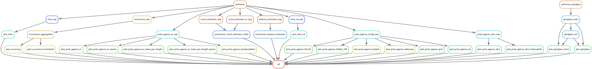

# Efficiently Estimating Cycle Statistics on Graphs via Spanning Trees

## About

This repository contains the evaluation workflow for the paper *Efficiently Estimating Cycle Statistics on Graphs via Spanning Trees*.

## Running numerical experiments

This project uses [Snakemake](https://snakemake.readthedocs.io).
To run the experiments:

1. Install [Miniconda](https://docs.conda.io/en/latest/miniconda.html) (or mamba)
2. Create a new conda environment and install dependencies: `conda env create -f workflow/envs/environment.yaml`
   - The versions we used are in `workflow/envs/environment-full.yaml`
3. Activate environment: `conda activate cycles`
4. Run snakemake: `snakemake -c100 all`

The full experiments can take multiple hours (or days in case of the longest runtime experiments).
You may prefer to only generate figures that require little computational resources using `snakemake -c20 quick` (takes around 30 minutes, most plots finish in less than five).

### Plot incomplete runtime experiments

The scripts for plotting the runtime experiments can also be called from the command line:

`python workflow/scripts/plot_time_rw.py results/time-rw/*/*.csv time_rw.pdf` and  
`python workflow/scripts/plot_time.py results/time/*.csv time.pdf`

This is useful to plot incomplete results (instead of waiting for the longest-running job to finish).

## Workflow structure

The Rulegraph gives a rough overview of the structure:

There are five main experiments:

- **prob_approx_{er,sbm,config}_exp**: Approximates the occurrence probability (for different settings).
- **occurrence_exp** / **occurrence_rw_exp**: Counts the cycles per length that occur in the sampled spanning trees on synthetic / real-world graphs (parallelized; `occurrence_aggregated` / `occurrence_aggregated_rw` aggregate again).
- **count_estimator_{,er_}exp** / **balance_estimator_exp**: Compares the cycle count / balance estimators (Horvitz-Thompson, one-cycle, and importance sampling with exact or approximate occurrence probabilities; Giscard as a baseline for balance). `summarize_count_estimator_table` / `summarize_balance_estimator` summarize the results as LaTeX tables.
- **time_exp** / **time_rw_exp**: Runtime experiment on synthetic / real-world graphs.
- **spinglass_exact** / **spinglass_sim**: Computes the ground state of spin glasses and estimates the frustration per cycle length for the ground state, simulated, and random states.

Synthetic graphs are generated by `workflow/scripts/graphs.py`, helpers shared by the scripts are in `workflow/scripts/script_utils.py`.
